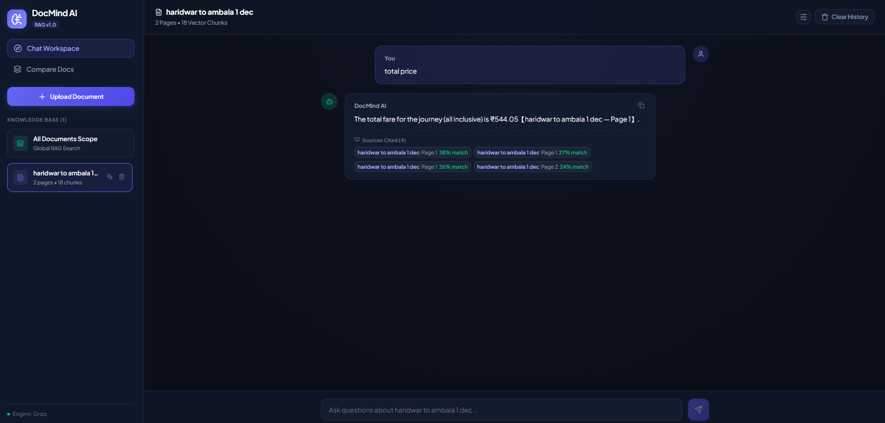
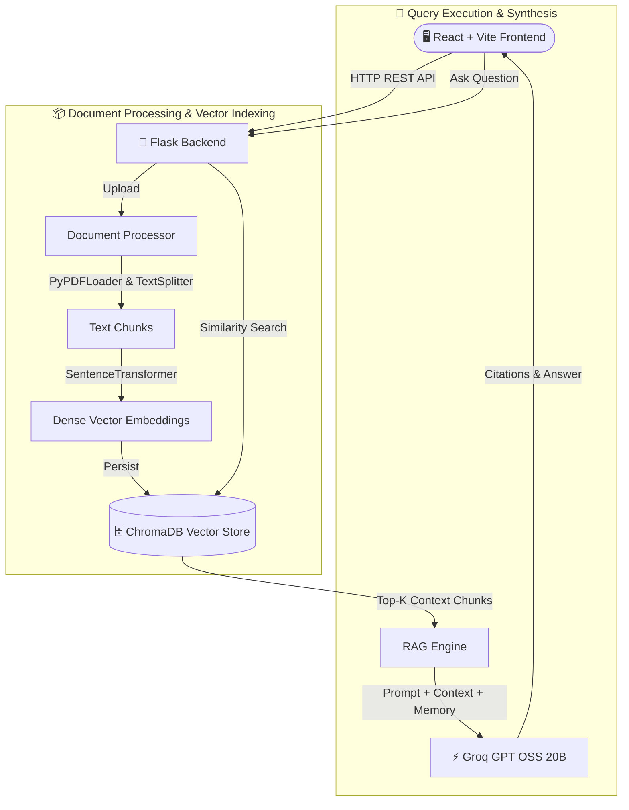

<div align="center">

# 🧠 IntelliDocs
### Multi-Document RAG Intelligence Platform

<br/>

[](https://www.python.org/)
[](https://flask.palletsprojects.com/)
[](https://reactjs.org/)
[](https://vitejs.dev/)

[](https://www.langchain.com/)
[](https://www.trychroma.com/)
[](https://groq.com/)
[](LICENSE)

<br/>

> **IntelliDocs** is a full-stack AI-powered document intelligence platform that lets you upload multiple documents, ask questions across them, compare them side-by-side, and generate executive AI summaries — all backed by blazing-fast Groq inference with GPT OSS 20B by default.

<br/>

---

</div>

## 📸 Screenshots



Document chat workspace showing an answer with document and page references.

---

## ✨ Key Features

| Feature | Description |
|---|---|
| 📄 **Multi-Format Ingestion** | Upload PDF, Markdown, and TXT files with intelligent text chunking |
| 🎯 **Semantic Vector Search** | `SentenceTransformer (all-MiniLM-L6-v2)` embeddings + persistent ChromaDB indexing |
| ⚡ **Groq AI Inference** | GPT OSS 20B by default, with retrieved document and page references |
| 📊 **Cross-Document Comparison** | Side-by-side contrast matrix across multiple documents |
| 🪄 **Executive Summary Generator** | One-click AI summaries with core topic extraction & key takeaways |
| 💬 **Conversational Memory** | In-memory multi-turn history separated by document scope |
| 🎨 **Glassmorphism UI** | Responsive React workspace with smooth animations & dark mode |
| 🔗 **Source Citations** | Retrieved source documents and page numbers accompany answers |

---

## 🏗️ Architecture



---

## 📁 Project Structure

```
IntelliDocs/
├── backend/
│   ├── app.py                   # Flask server entry point
│   ├── config.py                # Environment & model configurations
│   ├── requirements.txt         # Python dependencies
│   ├── .env.example             # Sample environment variables
│   ├── routes/
│   │   └── api.py               # REST API Blueprint endpoints
│   └── services/
│       ├── document_service.py  # File loader & text splitter service
│       └── rag_service.py       # ChromaDB, Embeddings & Groq RAG manager
│
├── frontend/
│   ├── package.json             # Vite + React dependencies
│   ├── vite.config.js           # Vite development configuration
│   ├── index.html               # Entry HTML
│   └── src/
│       ├── main.jsx             # React root mount
│       ├── App.jsx              # Main workspace layout & state
│       ├── App.css              # Glassmorphic UI styles
│       ├── index.css            # Design tokens & CSS variables
│       ├── api/client.js        # Axios API client module
│       └── components/
│           ├── Sidebar.jsx      # Document catalog & upload panel
│           ├── ChatArea.jsx     # Main chat workspace & citations
│           ├── CompareView.jsx  # Side-by-side document comparison
│           └── SummaryModal.jsx # Executive summary popup modal
│
├── .gitignore
└── README.md
```

---

## 🚀 Getting Started

### Prerequisites

- **Python** 3.10 or higher
- **Node.js** 22.12+ (or 20.19+) and npm
- A free [Groq API Key](https://console.groq.com/) *(takes 30 seconds to get)*

---

### 1️⃣ Clone the Repository

```bash
git clone https://github.com/Anmol-Kapil/IntelliDocs.git
cd IntelliDocs
```

---

### 2️⃣ Backend Setup

```bash
# Navigate to backend directory
cd backend

# Create virtual environment (recommended)
python -m venv venv

# Activate — Windows:
venv\Scripts\activate
# Activate — macOS/Linux:
source venv/bin/activate

# Install dependencies
pip install -r requirements.txt

# Copy the example env file
cp .env.example .env
```

Open `.env` and add your Groq API key:

```env
GROQ_API_KEY=gsk_your_actual_groq_api_key_here
GROQ_MODEL=openai/gpt-oss-20b
PORT=5002
```

Start the Flask server:

```bash
python app.py
```

The default Groq model is `openai/gpt-oss-20b`. Older Llama models may require
enterprise access. Restart the backend after changing `.env`. Groq connections
use the operating system's trusted certificate store with HTTPS verification enabled.

> ✅ API server will be running at `http://localhost:5002`

---

### 3️⃣ Frontend Setup

Open a **new terminal window**:

```bash
cd frontend

# Install dependencies
npm install

# Start Vite dev server
npm run dev
```

> ✅ App will be available at `http://localhost:3000`

The development and preview servers forward `/api` to `http://127.0.0.1:5002`.
For a separate deployed backend, set `VITE_API_BASE_URL` before building the frontend.
Static production hosting must forward `/api` to the backend if this variable is not set.
Uploads are limited to 25 MB per request. Scanned PDFs need OCR before upload.

### Verification

From the repository root with backend dependencies installed:

```bash
python -m unittest discover -s backend/tests -v
```

These tests use real document loaders and persistent Chroma storage with offline embedding
substitutes. They check API validation, uploads, retrieval, restart recovery, and deletion.
They do not verify real model quality or live Groq responses. Configure `GROQ_API_KEY` in
`backend/.env` to enable chat, comparison, and summaries; missing configuration returns HTTP 503.

From `frontend`, run `npm run build` and `npm audit` to check the production bundle and dependencies.

---

## 📡 API Reference

| Endpoint | Method | Description |
|---|---|---|
| `/api/health` | `GET` | Health check & document count |
| `/api/documents` | `GET` | List all indexed documents |
| `/api/documents` | `POST` | Upload & index a document (PDF, TXT, MD) |
| `/api/documents/<doc_id>` | `DELETE` | Delete a document & its vector embeddings |
| `/api/documents/<doc_id>/summary` | `GET` | Generate an AI executive summary |
| `/api/chat` | `POST` | Query RAG engine across single or all documents |
| `/api/compare` | `POST` | Perform cross-document comparison analysis |
| `/api/reset` | `POST` | Clear conversation history |

---

## 🛠️ Tech Stack

| Layer | Technology |
|---|---|
| **Frontend** | React 18, Vite, CSS Glassmorphism |
| **Backend** | Python, Flask, Flask-CORS |
| **RAG Framework** | LangChain |
| **Vector Database** | ChromaDB (persistent) |
| **Embeddings** | SentenceTransformers (`all-MiniLM-L6-v2`) |
| **LLM** | Groq — GPT OSS 20B (configurable) |
| **Document Loaders** | PyPDF, LangChain TextSplitter |

---

## 🤝 Contributing

Contributions are welcome! Feel free to open an issue or submit a pull request.

1. Fork the repository
2. Create your feature branch: `git checkout -b feature/amazing-feature`
3. Commit your changes: `git commit -m 'Add amazing feature'`
4. Push to the branch: `git push origin feature/amazing-feature`
5. Open a Pull Request

---

## 📜 License

This project is licensed under the **MIT License** — see the [LICENSE](LICENSE) file for details.

---

<div align="center">

Made with ❤️ and powered by ⚡ Groq

**⭐ Star this repo if you find it useful!**

</div>

## Validation and deployment notes

See [VERIFICATION.md](VERIFICATION.md) for completed checks and known limits.
The backend currently shares in-memory histories between visitors; add authentication
and user/session isolation before hosting it for multiple users. Scanned PDFs require OCR.
