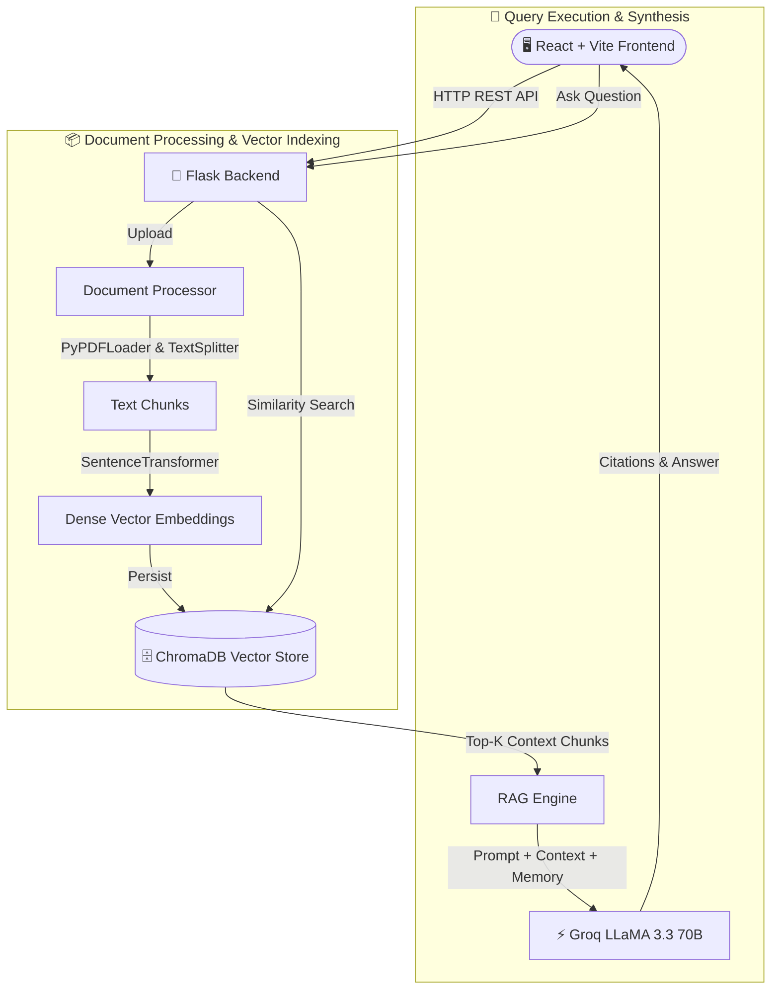
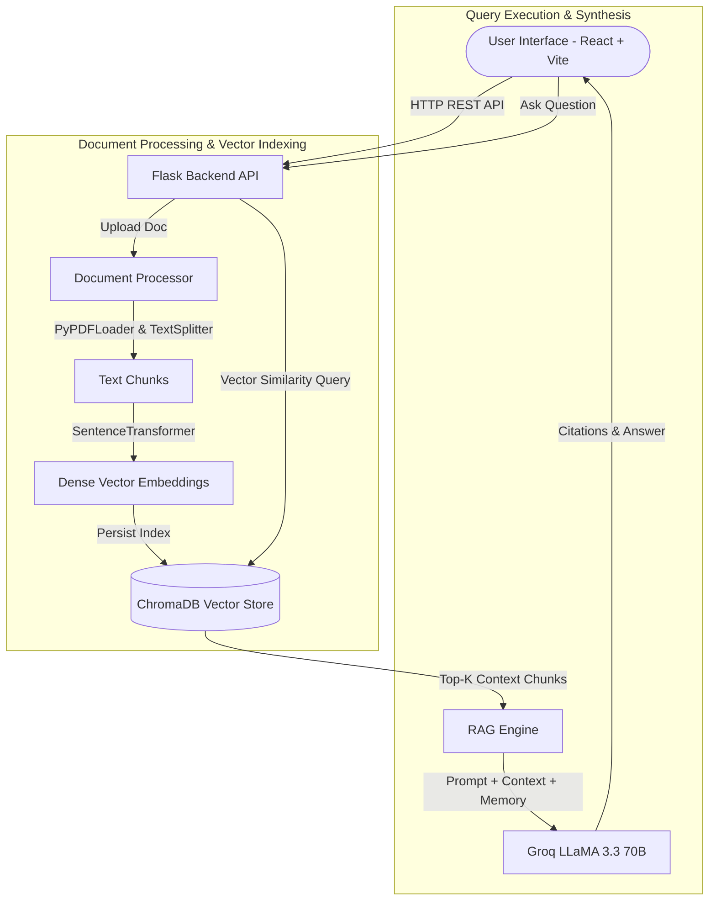

<div align="center">

# 🧠 IntelliDocs
### Multi-Document RAG Intelligence Platform

<br/>

[](https://www.python.org/)
[](https://flask.palletsprojects.com/)
[](https://reactjs.org/)
[](https://vitejs.dev/)

[](https://www.langchain.com/)
[](https://www.trychroma.com/)
[](https://groq.com/)
[](LICENSE)

<br/>

> **IntelliDocs** is a full-stack AI-powered document intelligence platform that lets you upload multiple documents, ask questions across them, compare them side-by-side, and generate executive AI summaries — all backed by blazing-fast Groq LLaMA 3.3 70B inference.

<br/>

---

</div>

## 📸 Screenshots

<!-- Add your screenshots here -->

---

## ✨ Key Features

| Feature | Description |
|---|---|
| 📄 **Multi-Format Ingestion** | Upload PDF, Markdown, and TXT files with intelligent text chunking |
| 🎯 **Semantic Vector Search** | `SentenceTransformer (all-MiniLM-L6-v2)` embeddings + persistent ChromaDB indexing |
| ⚡ **Groq LLaMA 3.3 70B** | Ultra-fast LLM inference with page-level citation verification |
| 📊 **Cross-Document Comparison** | Side-by-side contrast matrix across multiple documents |
| 🪄 **Executive Summary Generator** | One-click AI summaries with core topic extraction & key takeaways |
| 💬 **Conversational Memory** | Multi-turn chat with persistent conversation history per session |
| 🎨 **Glassmorphism UI** | Responsive React workspace with smooth animations & dark mode |
| 🔗 **Source Citations** | Every answer cites exact source documents and page numbers |

---

## 🏗️ Architecture



---

## 📁 Project Structure

```
IntelliDocs/
├── backend/
│   ├── app.py                   # Flask server entry point
│   ├── config.py                # Environment & model configurations
│   ├── requirements.txt         # Python dependencies
│   ├── .env.example             # Sample environment variables
│   ├── routes/
│   │   └── api.py               # REST API Blueprint endpoints
│   └── services/
│       ├── document_service.py  # File loader & text splitter service
│       └── rag_service.py       # ChromaDB, Embeddings & Groq RAG manager
│
├── frontend/
│   ├── package.json             # Vite + React dependencies
│   ├── vite.config.js           # Vite development configuration
│   ├── index.html               # Entry HTML
│   └── src/
│       ├── main.jsx             # React root mount
│       ├── App.jsx              # Main workspace layout & state
│       ├── App.css              # Glassmorphic UI styles
│       ├── index.css            # Design tokens & CSS variables
│       ├── api/client.js        # Axios API client module
│       └── components/
│           ├── Sidebar.jsx      # Document catalog & upload panel
│           ├── ChatArea.jsx     # Main chat workspace & citations
│           ├── CompareView.jsx  # Side-by-side document comparison
│           └── SummaryModal.jsx # Executive summary popup modal
│
├── .gitignore
└── README.md
```

---

## 🚀 Getting Started

### Prerequisites

- **Python** 3.10 or higher
- **Node.js** 18+ and npm
- A free [Groq API Key](https://console.groq.com/) *(takes 30 seconds to get)*

---

### 1️⃣ Clone the Repository

```bash
git clone https://github.com/YOUR_USERNAME/IntelliDocs.git
cd IntelliDocs
```

---

### 2️⃣ Backend Setup

```bash
# Navigate to backend directory
cd backend

# Create virtual environment (recommended)
python -m venv venv

# Activate — Windows:
venv\Scripts\activate
# Activate — macOS/Linux:
source venv/bin/activate

# Install dependencies
pip install -r requirements.txt

# Copy the example env file
cp .env.example .env
```

Open `.env` and add your Groq API key:

```env
GROQ_API_KEY=gsk_your_actual_groq_api_key_here
PORT=5002
```

Start the Flask server:

```bash
python app.py
```

> ✅ API server will be running at `http://localhost:5002`

---

### 3️⃣ Frontend Setup

Open a **new terminal window**:

```bash
cd frontend

# Install dependencies
npm install

# Start Vite dev server
npm run dev
```

> ✅ App will be available at `http://localhost:3000`

---

## 📡 API Reference

| Endpoint | Method | Description |
|---|---|---|
| `/api/health` | `GET` | Health check & document count |
| `/api/documents` | `GET` | List all indexed documents |
| `/api/documents` | `POST` | Upload & index a document (PDF, TXT, MD) |
| `/api/documents/<doc_id>` | `DELETE` | Delete a document & its vector embeddings |
| `/api/documents/<doc_id>/summary` | `GET` | Generate an AI executive summary |
| `/api/chat` | `POST` | Query RAG engine across single or all documents |
| `/api/compare` | `POST` | Perform cross-document comparison analysis |
| `/api/reset` | `POST` | Clear conversation history |

---

## 🛠️ Tech Stack

| Layer | Technology |
|---|---|
| **Frontend** | React 18, Vite, CSS Glassmorphism |
| **Backend** | Python, Flask, Flask-CORS |
| **RAG Framework** | LangChain |
| **Vector Database** | ChromaDB (persistent) |
| **Embeddings** | SentenceTransformers (`all-MiniLM-L6-v2`) |
| **LLM** | Groq — LLaMA 3.3 70B (ultra-fast inference) |
| **Document Loaders** | PyPDF, LangChain TextSplitter |

---

## 🤝 Contributing

Contributions are welcome! Feel free to open an issue or submit a pull request.

1. Fork the repository
2. Create your feature branch: `git checkout -b feature/amazing-feature`
3. Commit your changes: `git commit -m 'Add amazing feature'`
4. Push to the branch: `git push origin feature/amazing-feature`
5. Open a Pull Request

---

## 📜 License

This project is licensed under the **MIT License** — see the [LICENSE](LICENSE) file for details.

---

<div align="center">

Made with ❤️ and powered by ⚡ Groq

**⭐ Star this repo if you find it useful!**

</div>


---

## ✨ Features

- 📄 **Multi-Format Document Ingestion**: Support for PDF, Markdown, and TXT files with text chunking.
- 🎯 **Semantic Vector Search**: Powered by `SentenceTransformer (all-MiniLM-L6-v2)` embeddings and persistent `ChromaDB` vector indexing.
- ⚡ **Groq LLaMA 3.3 70B Acceleration**: Ultra-fast context synthesis with page citation verification and source relevance scoring.
- 📊 **Cross-Document Comparison Matrix**: Perform side-by-side contrast analysis across multiple uploaded documents.
- 🪄 **Executive Summary Generator**: One-click AI-synthesized document summaries with core topic extraction and key takeaways.
- 🎨 **Modern Dark Glassmorphism Interface**: Responsive React workspace built with Vite, CSS design variables, and smooth animations.

---

## 🏗️ Architecture Flow



---

## 📁 Repository Structure

```
DocMind-AI/
├── backend/
│   ├── app.py                   # Flask server entry point
│   ├── config.py                # Environment & model configurations
│   ├── requirements.txt         # Python dependencies
│   ├── .env.example             # Sample environment variables
│   ├── routes/
│   │   └── api.py               # REST API Blueprint endpoints
│   └── services/
│       ├── document_service.py  # File loader & text splitter service
│       └── rag_service.py       # ChromaDB, Embeddings & Groq RAG manager
│
├── frontend/
│   ├── package.json             # Vite + React dependencies
│   ├── vite.config.js           # Vite development configuration
│   ├── index.html               # Entry HTML
│   └── src/
│       ├── main.jsx             # React root mount
│       ├── App.jsx              # Main workspace layout & state
│       ├── App.css              # Glassmorphic UI styles
│       ├── index.css            # Design tokens & CSS variables
│       ├── api/client.js        # Axios API client module
│       └── components/
│           ├── Sidebar.jsx      # Document catalog & upload panel
│           ├── ChatArea.jsx     # Main chat workspace & citations
│           ├── CompareView.jsx  # Side-by-side document matrix comparison
│           └── SummaryModal.jsx # Executive summary popup modal
│
├── .gitignore
└── README.md
```

---

## 🚀 Getting Started

### Prerequisites
- Python 3.10 or higher
- Node.js 18+ and npm
- A free [Groq API Key](https://console.groq.com/)

---

### 1️⃣ Backend Setup

```bash
# Navigate to backend directory
cd backend

# Create virtual environment (optional but recommended)
python -m venv venv
# On Windows:
venv\Scripts\activate
# On macOS/Linux:
source venv/bin/activate

# Install dependencies
pip install -r requirements.txt

# Create .env file and set your Groq API Key
cp .env.example .env
```

Open `.env` and insert your Groq key:
```env
GROQ_API_KEY=gsk_your_actual_groq_api_key_here
PORT=5002
```

Start the backend server:
```bash
python app.py
```
The API server will run at `http://localhost:5002`.

---

### 2️⃣ Frontend Setup

Open a new terminal window:

```bash
# Navigate to frontend directory
cd frontend

# Install dependencies
npm install

# Start Vite development server
npm run dev
```

Open your browser at `http://localhost:3000`.

---

## 📡 API Reference

| Endpoint | Method | Description |
| :--- | :--- | :--- |
| `/api/health` | `GET` | Health check & document count |
| `/api/documents` | `GET` | List all indexed documents |
| `/api/documents` | `POST` | Upload & index document (PDF, TXT, MD) |
| `/api/documents/<doc_id>` | `DELETE` | Delete document & vector embeddings |
| `/api/documents/<doc_id>/summary` | `GET` | Generate executive AI summary |
| `/api/chat` | `POST` | Query RAG engine across single or all docs |
| `/api/compare` | `POST` | Perform cross-document matrix comparison |
| `/api/reset` | `POST` | Clear conversation history |

---

## 📜 License

This project is licensed under the MIT License - see the [LICENSE](LICENSE) file for details.
